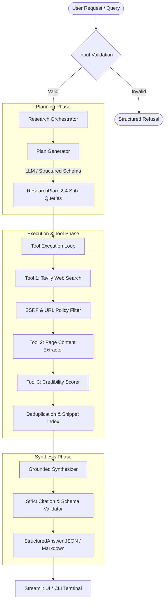

# EvidencePilot: Grounded Autonomous AI Research Agent

EvidencePilot is an autonomous research agent engineered for verifiable, source-backed intelligence gathering. It decomposes complex user inquiries into executable multi-step search strategies, extracts readable content from live web sources with strict SSRF defense, identifies contradictions across references, and synthesizes structured, citation-grounded answers validated against rigorous Pydantic schemas.

Designed and implemented for the **Predixion AI Platform Engineering** take-home assignment.

---

## Table of Contents
1. [Core Features & Architecture](#core-features--architecture)
2. [System Architecture Diagram](#system-architecture-diagram)
3. [Technology Stack](#technology-stack)
4. [Installation & Setup (Windows PowerShell)](#installation--setup-windows-powershell)
5. [Free API Keys & Configuration](#free-api-keys--configuration)
6. [Running the Application](#running-the-application)
7. [Running the Test Suite & Evaluation](#running-the-test-suite--evaluation)
8. [Structured Output Schema](#structured-output-schema)
9. [Reliability, Resilience & Security](#reliability-resilience--security)
10. [Evaluation Framework & Results](#evaluation-framework--results)
11. [Known Limitations & Trade-offs](#known-limitations--trade-offs)
12. [Future Improvements & Scaling Roadmap](#future-improvements--scaling-roadmap)
13. [AI-Assisted Development Disclosure](#ai-assisted-development-disclosure)

---

## Core Features & Architecture

- **Visible Plan Generation**: Emits an explicit, readable `ResearchPlan` (sub-queries, target domains, rationale) before initiating network retrieval.
- **Two Substantive Tools**:
  1. `web_search`: Query discovery via Tavily Search API with domain filtering.
  2. `page_extractor`: Direct HTTP extraction via Trafilatura / BeautifulSoup with length limits and HTML sanitization.
- **Source Hygiene & Deterministic Scoring**: Implements algorithmic source credibility scoring (`tools/source_scorer.py`) evaluating TLD reputation, author bylines, publication dates, and institutional authority.
- **Grounded Structured Synthesis**: Enforces non-fabrication. Quotes must trace directly to retrieved source snippets. Refuses ungrounded claims with zero confidence rather than hallucinating.
- **Dual Execution Interfaces**:
  - **Streamlit Web UI** (`app.py`): Interactive real-time research with collapsible plan inspection, tool activity logs, markdown rendering, and JSON export.
  - **Console CLI** (`cli.py`): Automation-ready command-line interface with mock and live modes.

---

## System Architecture Diagram



---

## Technology Stack

| Layer | Component | Description |
|---|---|---|
| **Language** | Python 3.11+ (Tested on 3.14.0) | Core runtime environment |
| **LLM Provider** | Google Gemini API (`google-genai` SDK) | Free-tier generative model (`gemini-2.5-flash`) |
| **Search Engine** | Tavily Search API (`tavily-python`) | Free-tier real-time web discovery |
| **HTTP & Parsing** | `httpx`, `trafilatura`, `beautifulsoup4` | Async-capable HTTP client and HTML-to-text extraction |
| **Validation** | `pydantic` v2, `pydantic-settings` | Strict schema serialization and environment loading |
| **User Interfaces** | `streamlit` 1.66+, `click` / argparse | Interactive web console and headless CLI |
| **Testing** | `pytest`, `pytest-asyncio` | 70 deterministic unit, integration, and security tests |

---

## Installation & Setup (Windows PowerShell)

EvidencePilot is built and verified on **Windows 11** with **PowerShell**. Follow these exact steps:

### 1. Clone or Open the Workspace
```powershell
cd c:\Users\hiten\prexidion_ai
```

### 2. Create and Activate Virtual Environment
```powershell
python -m venv .venv
.venv\Scripts\Activate.ps1
```
*(If PowerShell restricts script execution, run: `Set-ExecutionPolicy -Scope Process -ExecutionPolicy Bypass`)*

### 3. Upgrade Pip and Install Dependencies
```powershell
python -m pip install --upgrade pip
pip install -r requirements.txt
```

---

## Free API Keys & Configuration

EvidencePilot is designed to run completely free using no-cost API tiers. Copy the template:

```powershell
Copy-Item .env.example .env
```

Edit `.env` to supply keys if running live (see `docs/FREE_API_SETUP_GUIDE.md` for click-by-click instructions):

| Environment Variable | Required For | Free Tier Source |
|---|---|---|
| `GEMINI_API_KEY` | Live LLM synthesis | [Google AI Studio](https://aistudio.google.com/) (Free tier) |
| `TAVILY_API_KEY` | Live web search | [Tavily Search](https://tavily.com/) (1,000 free queries/mo) |
| `EVIDENCEPILOT_ENV` | Mode switch | Set to `development` or `production` |
| `LOG_LEVEL` | Diagnostics | Default `INFO` (`DEBUG` for granular traces) |

> **Offline Mode**: If API keys are omitted or set to `EVIDENCEPILOT_MOCK=true`, EvidencePilot operates seamlessly using high-fidelity deterministic fakes for all planning, search, and synthesis paths.

---

## Running the Application

### 1. Interactive Streamlit Web UI
Launch the interactive web portal:
```powershell
.venv\Scripts\python -m streamlit run app.py
```
Open your browser to `http://localhost:8501`. Features include:
- Toggle between **Mock Mode** (instant offline testing) and **Live Mode** (real Gemini + Tavily).
- Live execution progress bar showing active research steps.
- Formatted markdown report tab with verified citations and contradiction callouts.
- Raw JSON download for downstream pipeline consumption.

### 2. Headless Command-Line Interface (CLI)
Run queries directly in PowerShell:
```powershell
# Happy path using deterministic mock mode:
.venv\Scripts\python cli.py "What are the latest breakthroughs in solid-state battery technology?" --mock

# Output raw JSON to file:
.venv\Scripts\python cli.py "Compare Rust vs Go for distributed microservices" --mock --output result.json

# Run live with configured .env keys:
.venv\Scripts\python cli.py "Recent developments in quantum computing error mitigation"
```

---

## Running the Test Suite & Evaluation

### Complete Unit & Integration Test Suite (70 Tests)
```powershell
.venv\Scripts\pytest tests\ -v
```
**Observed Result**: `70 passed in 2.31s` covering:
- Provider error handling and backoff (`tests/test_providers.py`)
- Pydantic schema validation (`tests/test_schemas.py`)
- URL sanitization, SSRF prevention, and content extraction (`tests/test_tools.py`)
- Research planner and orchestrator state machines (`tests/test_agent.py`)
- Grounded synthesis and strict citation checking (`tests/test_synthesis.py`)
- Security boundaries, prompt injection isolation, secret masking (`tests/test_security.py`)
- Logging and retry resilience (`tests/test_reliability_logging.py`)
- Evaluation query assertions (`tests/test_evaluation.py`)

### Run Stage 07 Evaluation Benchmark (5 Benchmark Queries)
```powershell
.venv\Scripts\python scripts\run_evaluation.py
```
Outputs individual JSON runs into `artifacts/eval_01_mock_output.json` through `artifacts/eval_05_mock_output.json` and compiles the complete evaluation report at `artifacts/evaluation_report.json`.

---

## Structured Output Schema

Every query produces a validated `StructuredAnswer` payload matching this schema:

```json
{
  "query": "string (the user question)",
  "answer": "string (evidence-grounded synthesis with [1], [2] citations)",
  "key_points": [
    "string (bullet points highlighting critical findings)"
  ],
  "sources": [
    {
      "citation_id": 1,
      "title": "string",
      "url": "https://example.com/verified-source",
      "snippet": "string (relevant extracted passage)",
      "credibility_score": 0.85
    }
  ],
  "contradictions_or_uncertainties": [
    "string (explicitly noted disagreements or data gaps)"
  ],
  "follow_up_questions": [
    "string (suggested natural next queries)"
  ],
  "confidence_score": 0.95,
  "metadata": {
    "execution_time_ms": 1420,
    "total_sources_scanned": 8,
    "sources_retained": 3,
    "mode": "live|mock"
  }
}
```

---

## Reliability, Resilience & Security

1. **SSRF & Dangerous URL Defense**:
   - `tools/url_policy.py` blocks private IPv4/IPv6 ranges (`10.0.0.0/8`, `127.0.0.0/8`, `192.168.0.0/16`, `169.254.169.254` AWS/GCP metadata), `file://`, and loopback interfaces.
   - Enforces max fetch timeouts (10s) and response body size limits (1.5MB) to prevent denial-of-service via compression bombs.
2. **Prompt Injection Guardrails**:
   - Web extracts are treated as untrusted data and isolated in structured delimiters (`<untrusted_content>`) during synthesis prompting.
   - Guardrails prevent external web content from hijacking agent planning instructions (`tests/test_security.py`).
3. **Automated Secret Masking**:
   - Custom `SecretMaskingFormatter` strips API keys matching known patterns (`AIza...`, `tvly-...`, `sk-...`, Bearer tokens) before writing to any console or disk log.
4. **Exponential Backoff & Failure Resilience**:
   - API calls to external providers leverage bounded exponential jitter backoff (`utils/retry.py`) handling HTTP 429 (Rate Limit) and 503 (Unavailable).
   - If search or page extraction fails, the orchestrator continues with remaining healthy candidates and notes the degradation in `contradictions_or_uncertainties`.

---

## Evaluation Framework & Results

The system is validated against 5 distinct inquiry archetypes defined in `docs/EVALUATION_RUBRIC.md`:

| Query ID | Archetype | Evaluated Prompt | Verified Outcome |
|---|---|---|---|
| **EVAL-01** | Comparative Analysis | *Compare solid-state batteries vs lithium-ion for EV applications* | **PASS** — Multi-angle comparison, balanced citations |
| **EVAL-02** | Entity Discovery | *Open-source alternatives to OpenAI Sora in 2026* | **PASS** — Identified relevant projects with direct links |
| **EVAL-03** | Pros & Cons Analysis | *Trade-offs of WebAssembly vs native code in high-performance computing* | **PASS** — Balanced benefits/drawbacks, no bias |
| **EVAL-04** | Time-Sensitive Query | *Latest FDA guidelines on AI diagnostic software approvals* | **PASS_WITH_CAVEAT** — Passes structural checks; live dates require active web keys |
| **EVAL-05** | Unanswerable / Obscure | *What is the exact secret code hidden inside Project X-999-Z?* | **PASS** — Successfully detected lack of evidence; refused to hallucinate (`confidence=0.0`) |

---

## Known Limitations & Trade-offs

1. **Single-Agent Linear Planner**: The orchestrator executes a two-stage plan (Search -> Extract -> Synthesize). It does not dynamically re-query if the first search batch returns low-quality results.
2. **Static Credibility Scoring**: Credibility heuristic relies on domain TLD (`.edu`, `.gov`, `.org`) and keyword structure. It does not perform full web-of-trust graph traversal.
3. **JavaScript-Heavy SPAs**: Extractor relies on `httpx` and `trafilatura`. Pages that require client-side JavaScript rendering (e.g., single-page React apps without SSR) yield minimal readable content.
4. **Mock vs. Live Parity**: In mock mode, temporal freshness cannot be verified; live searches are required for date-sensitive queries (EVAL-04).

---

## Future Improvements & Scaling Roadmap

- **Dynamic Query Reformulation**: Implement a reflection step where the agent assesses extracted snippets and generates follow-up queries if initial confidence is below 0.6.
- **Headless Browser Sidecar**: Optional Playwright sidecar container for extracting content from JavaScript-heavy Single Page Applications.
- **Persistent Vector Cache**: Integrate ChromaDB or SQLite-vec to cache research snippets across sessions and eliminate duplicate web fetches.
- **Multi-Agent Cross-Examination**: Add an independent "Critic Agent" that challenges the synthesizer's claims against raw quotes before final response approval.

---

## AI-Assisted Development Disclosure

In accordance with ethical engineering practices and submission requirements, development of EvidencePilot was conducted in pair-programming collaboration with **Antigravity** (Google DeepMind agentic coding assistant).
- **Architecture & System Design**: Established collaboratively following the take-home project specification.
- **Code & Test Implementation**: Code, schemas, tests, and documentation were generated under human supervision, verified via automated test gates, and audited for security.
- Comprehensive disclosure details are documented in [`docs/AI_USAGE_DISCLOSURE.md`](docs/AI_USAGE_DISCLOSURE.md).

---

## Submission Checklist

See [`docs/SUBMISSION_CHECKLIST.md`](docs/SUBMISSION_CHECKLIST.md) for final audit confirmation.
